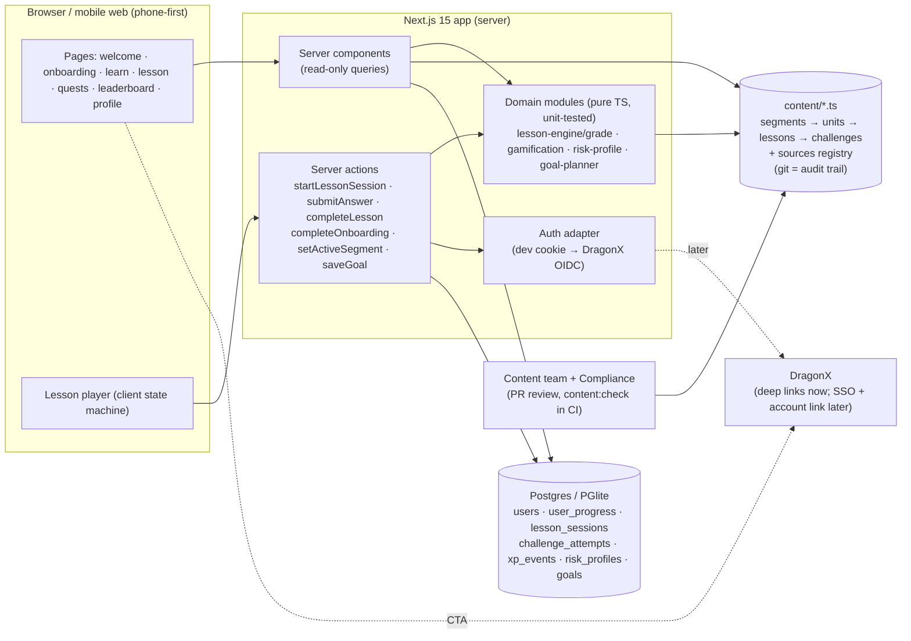
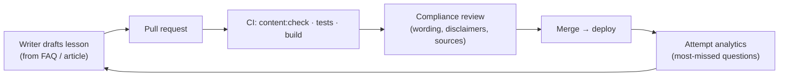
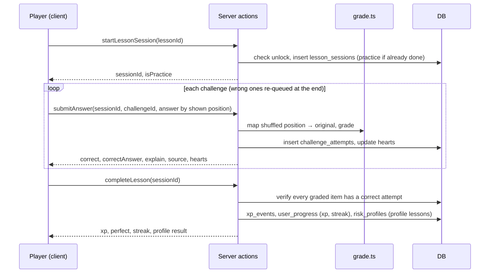
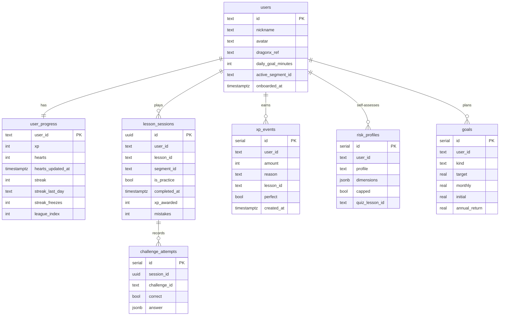

# Rồng DC Academy: architecture

A Duolingo-style learning game for **investors** of Dragon Capital. Five-minute lessons, XP, streaks,
hearts, leagues and the Rồng DC mascot, built on the structure of
[`Davronov-Alimardon/duolingo-clone`](https://github.com/Davronov-Alimardon/duolingo-clone).

> Companion docs: [`CURRICULUM.md`](./CURRICULUM.md) (the 142-lesson program, generated from `content/outline/`),
> [`FEATURES.md`](./FEATURES.md) (the full feature list, including AI practice) and
> [`MINDMAP.md`](./MINDMAP.md) (the whole plan on one page).

---

## 1. Inputs and what each one contributes

| Input | Used for |
|---|---|
| **Investor365 Learn prototype** (artifact) | UX and visual system: phone-first column, jade / gold / coral / sky tokens, Baloo 2 + Nunito, chunky "3D" buttons, zig-zag lesson path, units, chest/trophy nodes, hearts, streak, quests, leagues ("Hạng Ngọc Bích"), result screen, and **"Nguồn: …" under every explanation**. Question types: select, true/false, match, calc, scenario. The prototype targets *staff*; this game targets *investors*, so roles become experience levels, and colleague/branch leaderboards become nickname-only ones. |
| **Rồng DC** (10 mascot renders) | `public/mascot/*.png`, one pose per meaning: `explore` onboarding · `study` concepts · `grow` compounding/DCA · `analyze` numbers · `save` safety/emergency fund · `fight` streak/motivation · `celebrate` XP · `trophy` unit done/league · `gift` chests/quests · `sad` wrong answer/out of hearts/market drop. |
| **Tư vấn sản phẩm hoàn chỉnh** (FAQ, 135 Q&A) | Segment A: Quỹ DC. Every question cites "Câu N". |
| **AMDD – Content** (16 articles) | Segment B: risk self-assessment, goals (1 tỷ đầu tiên, du học, nghỉ hưu, quỹ tự do sự nghiệp), discipline (DCA, timing, Sell in May, DCDS 10 năm). |
| **Articles W5** (MMF, Index, Active vs Passive, Bond, Balanced) | Segment C: fund types. Banners and thumbnails can be used as unit covers. |
| **duolingo-clone repo** | Architecture template: Next.js App Router, server actions, Drizzle + Postgres, course → unit → lesson → challenge hierarchy, hearts/points, practice-to-refill, quests, leaderboard, marketing/main/lesson route groups. The repo has **no licence file**, so it is used as a structural reference only and the code here is written from scratch. |

## 2. What we keep, change and drop from the clone

| Clone | Rồng DC Academy | Why |
|---|---|---|
| Next.js 14, server actions | **Next.js 15**, server actions, React 19 | Same model, current versions |
| Drizzle + Neon Postgres | Drizzle + **any Postgres**; **embedded PGlite** when `DATABASE_URL` is empty | Zero-setup local dev; production DB can be hosted in Vietnam if data rules require |
| Courses/units/lessons/challenges as **DB rows**, edited via react-admin | **Content-as-code** (`/content/*.ts`, Zod-validated), DB stores only learner state | Every wording change goes through a PR = audit trail for Compliance. No migrations to add a lesson. |
| Serial integer ids | **Stable string ids** (`a1-ccq-nav`) | Content can be reordered without breaking progress |
| 2 challenge types (SELECT, ASSIST) | **9 types**: info, select, true_false, match, order, numeric, scenario, profile, goal_planner | Finance needs calculation, scenarios, self-assessment and planners |
| Correct option sent to the browser; client decides | **Server-side grading**; options shuffled deterministically; answer keys never leave the server | XP and leaderboards can't be forged |
| Lesson complete = all challenge rows done | **Lesson sessions** + attempt log; server verifies completion and "perfect" from stored attempts | Integrity + analytics on which questions confuse investors |
| Clerk auth | **Auth adapter** (`src/lib/auth.ts`): anonymous dev cookie now, DragonX SSO (OIDC) later | Investors already have DragonX identities |
| Stripe Pro tier, shop buys hearts | **Dropped.** Hearts refill over time or by practising | Paywalling financial education for clients is the wrong incentive |
| Global points leaderboard with real names | Weekly **leagues**, **nickname only** | Investors are customers; privacy |
| Sounds, ElevenLabs voices | Not in skeleton (planned: sounds, optional Vietnamese TTS for info cards) | |

## 3. System overview



### Repository layout

```
content/
  schema.ts            Zod schemas: segment → unit → lesson → challenge (9 types), sources
  sources.ts           every citable document, with asOf date
  segments/            dc-funds.ts (A) · my-plan.ts (B) · fund-types.ts (C)
  index.ts             registry, lookups, validateContent() integrity checks
  outline/             the PLAN: 3 stages · 25 units · 142 lessons · 14 AI scenarios, tested for
                       source validity and full coverage of the 133 FAQ questions
drizzle/               generated SQL migrations
public/mascot/         Rồng DC poses (384px PNG)
scripts/check-content.ts   CI gate for content PRs
src/
  app/                 routes (see §8)
  actions/             server actions: lesson.ts, user.ts
  db/                  schema.ts, client.ts (Postgres | PGlite), queries.ts
  features/
    lesson-engine/     grade.ts, shuffle.ts, types.ts, player.tsx, challenge-views.tsx
    gamification/      rules.ts (all tunables), engine.ts (xp, hearts, streak, leagues), quests.ts
    risk-profile/      scoring.ts (willingness capped by ability → 5 profiles)
    goal-planner/      finance.ts (FV, months-to-target, required monthly, CAGR)
  components/          button (3D), mascot, status-bar, tab-bar, disclaimer
  lib/                 auth.ts, utils.ts
```

## 4. Content model

```
Segment  { id, code, title, subtitle, heartsEnabled, units[] }
└ Unit   { id, title, description, color, mascot, lessons[] }
  └ Lesson { id, title, kind: standard | profile | checkpoint, xp, minutes, challenges[] }
    └ Challenge (discriminated union on `type`) + { id, explain?, source? { sourceId, locator } }
```

| Type | Learner does | Graded | Example |
|---|---|---|---|
| `info` | reads a teaching card with a mascot pose | no | "Chứng chỉ quỹ là gì?" |
| `select` | picks one option | yes | NAV/CCQ là gì? |
| `true_false` | Đúng / Sai | yes | "Ngân hàng giám sát bảo đảm vốn" |
| `match` | pairs left ↔ right | yes | fund ↔ asset class |
| `order` | puts items in sequence | yes | volatility low → high; steps after a phishing click |
| `numeric` | types a number (accepts `126,05`, `23.700`) | yes, with tolerance | NAV after a 1.300 đ dividend |
| `scenario` | answers a customer-style chat | yes | FIFO holding-period question |
| `profile` | self-assessment, each option scored | no (feeds risk profile) | "Danh mục giảm 20%, bạn sẽ…" |
| `goal_planner` | enters target / monthly / return; sees projection | no (saves a goal) | "1 tỷ đầu tiên" |

**Rules enforced by `validateContent()`** (runs in tests and `npm run content:check`): unique ids across all
content, answer indexes in range, match pairs form a permutation, graded questions must cite a source, every
source id resolves, profile lessons contain only profile/info items.

**Time-sensitive facts** (fee tables, cut-off times, NAV) must not be hard-coded into question text; the FAQ
itself warns they change. Next step: a dated `fund-facts` table (fund, field, value, asOf, source) that
question templates read from, with an expiry alert.

### Content workflow



A non-developer editor (Decap/TinaCMS on top of the same files, or an admin UI that opens PRs) can come later
without changing the model.

## 5. Lesson engine



- The client receives `ClientChallenge` objects: shuffled options, **no** answer, pairs, scores, tolerance or
  explanation (a test asserts this for every challenge).
- Shuffling is deterministic per challenge id (`shuffle.ts`), so server and client agree without storing it.
- The lesson page render has **no side effects**; the session is created by the player on mount. (A
  revalidation after `completeLesson` would otherwise create a new session and wipe the result screen; this
  was caught by the end-to-end run.)

## 6. Data model



`lesson_id` / `challenge_id` are content ids (strings), not foreign keys. `xp_events` is an append-only ledger:
weekly leagues and daily quests are window sums over it.

## 7. Game design for investors

| Mechanic | Rule (all tunables in `features/gamification/rules.ts`) |
|---|---|
| XP | 15 per lesson (+5 perfect), 30 per checkpoint, 5 for practice |
| Hearts | 5 max; −1 per wrong answer in segments A and C; **off in segment B** (self-assessment has no wrong answers); +1 per 4 h; +1 per correct answer while practising. No purchase. |
| Streak | Counted in **Asia/Ho_Chi_Minh** calendar days; 1 freeze bridges a missed day |
| Leagues | Đồng → Bạc → Vàng → Ngọc Bích → Lam Ngọc → Kim Cương; groups of 30; top 5 up, bottom 5 down weekly; nickname only |
| Daily quests | Earn 20 XP · 1 perfect lesson · 1 correct scenario |
| Path | Linear unlock inside a segment; segments are independent so an investor can start where they are |
| Checkpoints | End-of-unit tests (`kind: checkpoint`) |
| Planned | Badges ("Nhà đầu tư hiểu biết"), chests, monthly challenges, certificates, friend referral via DragonX |

**Personalisation loop.** Onboarding asks experience (new / some / DC investor) and picks the starting segment.
The segment B self-assessment produces one of five profiles (Bảo toàn, Thận trọng, Cân bằng, Tăng trưởng,
Năng động). Willingness (tolerance + knowledge) sets a band, ability (emergency fund + horizon) caps it. The
profile recommends **which fund-type units to study next** and which DC fund documents to read. It is framed as
education, never as a product recommendation.

## 8. Routes

| Route | Purpose |
|---|---|
| `/` | Welcome (redirects to `/learn` once onboarded) |
| `/onboarding` | Experience → starting segment, daily goal, nickname |
| `/learn` | Path of the active segment: units, zig-zag nodes, mascot |
| `/segments` | Switch between A / B / C with progress |
| `/lesson/[lessonId]` | Lesson player (practice mode if already completed) |
| `/quests` · `/leaderboard` · `/profile` | Daily quests · weekly league · risk profile, goals, DragonX CTA |

## 9. Compliance and trust guardrails

- Every graded question cites a source document and locator; the player shows it under the explanation.
- Disclaimer component wherever numbers, funds or projections appear; returns in planners are labelled as assumptions.
- No hard-coded fees or cut-off times; dated fund facts with expiry (planned).
- The risk quiz is educational and distinct from the DragonX suitability assessment; wording and score bands need sign-off (`dc-risk-quiz` source is marked draft).
- Risk-profile output links to *learning*, and lists funds only as "documents to read".
- Leaderboards are nickname-only; linking a DragonX account requires explicit consent (`users.dragonx_ref`).
- Content changes are PR-reviewed; git history is the audit trail.

## 10. Auth and DragonX integration

| Phase | Identity | DragonX |
|---|---|---|
| Now (skeleton) | Anonymous learner cookie set by middleware | Deep-link CTA on profile |
| v1 | OIDC SSO with DragonX (Auth.js or Clerk behind `getUserId()`); anonymous progress merged on first login | "Open account" and "Set up DCA" deep links at unit ends |
| v2 | Same | Embedded in DragonX app as a webview tab; optional, consented link to holdings for personalised lessons ("you hold DCDS: learn how FIFO affects your sell fee") |

## 11. Non-functional

- **Hosting**: any Node host (Vercel, or a VN cloud / on-prem container if data residency requires). Postgres
  via `DATABASE_URL`. Set `MIGRATE_ON_BOOT=false` and run migrations as a deploy step in production.
- **Performance**: content is in-memory; pages are server-rendered; client JS ≈ 127 kB on the lesson page.
- **Accessibility**: focus rings, `aria-pressed` on choices, `role=status` feedback, reduced-motion respected, light/dark via CSS variables.
- **i18n**: Vietnamese first. English later by adding a `locale` dimension to content files.
- **Analytics**: `challenge_attempts` gives per-question accuracy; add product analytics (PostHog/GA) for funnels: onboarding → first lesson → day-2 return → DragonX CTA.

## 12. Roadmap

| Phase | Scope |
|---|---|
| **0 · Skeleton** (this repo) | 3 segments, 13 units, 19 playable lessons; detailed outline of 142 lessons and 14 AI scenarios; full game loop; PGlite dev DB; unit tests; E2E-verified |
| **1 · MVP pilot** (≈6 weeks) | Write the outline lessons, Hiểu mình first (see CURRICULUM); 5 AI practice scenarios; Compliance review; fund-facts table; DragonX SSO; sounds; badges; Postgres + deploy; internal pilot with staff |
| **2 · Public beta** | League groups + weekly cron; push/email streak reminders; unit chests; analytics dashboards; content editor UI |
| **3 · Integration** | DragonX webview embedding; consented holdings-aware lessons; AI practice chat grounded on the FAQ (prototype's "Luyện tình huống AI") with guardrails |

## 13. Open questions for the business

1. Which team owns content sign-off, and what turnaround is acceptable per lesson?
2. Can the risk self-assessment be shown publicly, or only after login?
3. Are rewards allowed (e.g. fee waivers, gifts) and under what promotion rules?
4. Data residency: must learner data stay in Vietnam?
5. Web app, DragonX tab, or both at launch?
