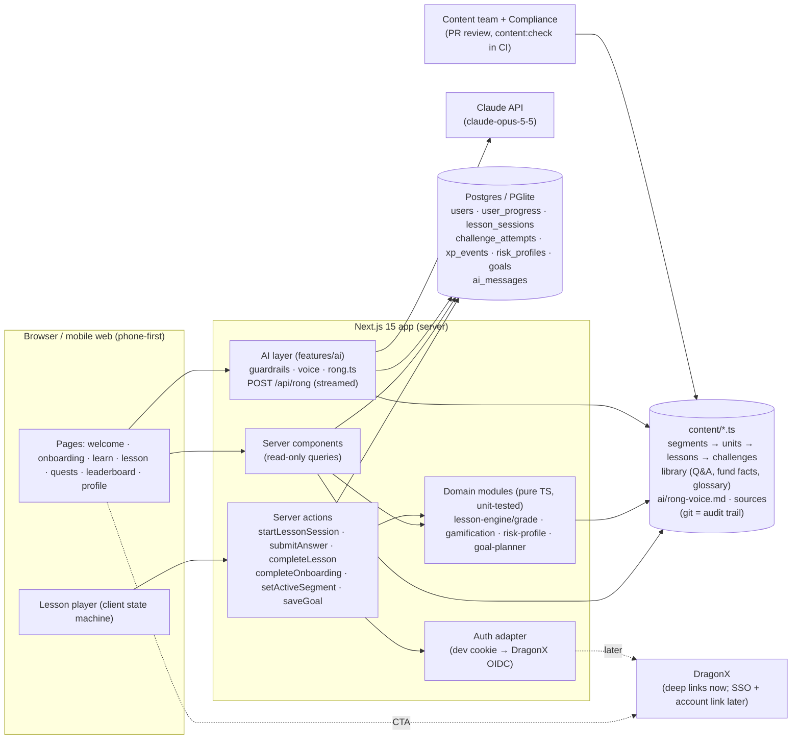
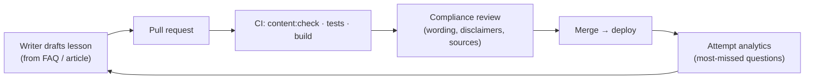
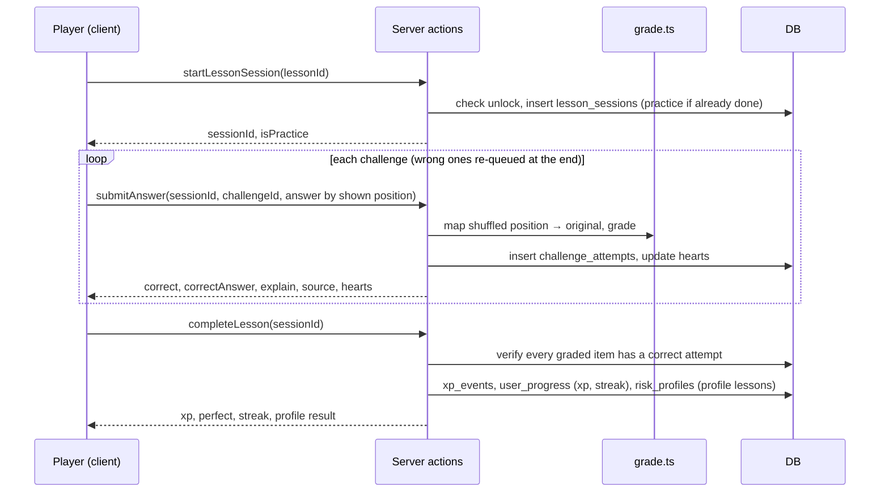
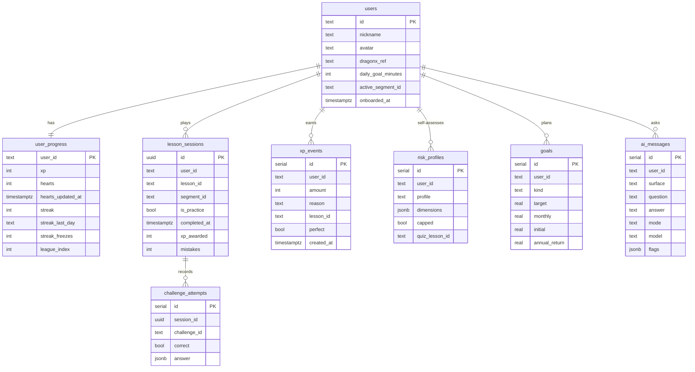

# Rồng DC Academy: architecture

A Duolingo-style learning game for **investors** of Dragon Capital. Five-minute lessons, XP, streaks,
hearts, leagues and the Rồng DC mascot, built on the structure of
[`Davronov-Alimardon/duolingo-clone`](https://github.com/Davronov-Alimardon/duolingo-clone).

> Companion docs: [`CURRICULUM.md`](./CURRICULUM.md) (the 142-lesson program, generated from `content/outline/`),
> [`FEATURES.md`](./FEATURES.md) (the full feature list, including AI practice),
> [`MINDMAP.md`](./MINDMAP.md) (the whole plan on one page), [`QUIZ_FORMULA.md`](./QUIZ_FORMULA.md),
> [`GOLDEN_PATH.md`](./GOLDEN_PATH.md) and [`PLAN.md`](./PLAN.md) (what to build next).

---

## 0. Review, October 2026

**What held up.** Content-as-code with Zod validation and tests absorbed two large rewrites (the quiz
formula and the merged FAQ library) without touching the database or the lesson engine. Server-side
grading, deterministic shuffling, pure domain modules and the auth seam (`getUserId()`) need no change.

**What changed since the skeleton.**

| Area | Before | Now |
|---|---|---|
| Questions | 9 types, free-form `select`, `true_false` | 10 types; every graded item is **context → question → 3 options → insight** with a pattern tag, enforced by the schema (`true_false` removed; `estimate` and `spot` added) |
| Risk self-check | percentage bands, knowledge lowered the result, no explanation | DC **Risk Scoring Framework v2.3** in `content/risk`: 7 questions, total 7–30 → 5 profiles, override rules ①–④, §5 confirmation (agree / one step lower / one step higher with acknowledgement) stored with §5.2 flags for Compliance |
| Facts | "don't hard-code fees" (planned table) | `content/library/fund-facts.ts` is the single source; tests check the numbers quoted in lessons |
| FAQ | one 133-question document, cited as "Câu N" | `content/library`: 208 investor-facing Q&As in 17 categories + 45-term glossary, merged from both FAQ documents; every source row merged or excluded with a reason |
| Sources | shown under every explanation | only published articles are shown; internal documents (`internal: true`) stay in the audit trail |
| AI | prototype only | `src/features/ai` + `/api/rong` + `/rong` page: guardrails in code, voice in `content/ai/rong-voice.md`, answers logged to `ai_messages` |
| Prototype | hand-built in a scratch folder | sources in `prototype/src`, built from live content with `npm run proto:build` |
| Quality gates | unit tests | + CI workflow and an end-to-end golden path on a production build |

**Gaps and risks, in priority order** (each has an item in [`PLAN.md`](./PLAN.md)):

1. **No eval for AI answers.** Voice and prompt changes are judged by eye. Build the Hỏi Rồng eval set before tuning tone.
2. **Two lesson definitions.** The prototype's lessons are hand-written JS, separate from `content/segments`; they will drift. Generate one from the other.
3. **Content volume.** 19 of 142 outlined lessons are built; the outline is the bottleneck, not the engine.
4. **AI practice is prototype-only.** The role-play and coach (the feature the business liked most) are not in the app yet.
5. **Guardrail flags are logged, not acted on.** Compliance needs a review page; `/api/rong` needs a per-user cap.
6. **Voice mismatch.** Library answers are written in CS voice ("anh/chị"); Rồng speaks to "bạn". The model rephrases; the offline fallback does not.
7. **Identity and hosting** are still the dev cookie and PGlite.

---

## 1. Inputs and what each one contributes

| Input | Used for |
|---|---|
| **Investor365 Learn prototype** (artifact) | UX and visual system: phone-first column, jade / gold / coral / sky tokens, Baloo 2 + Nunito, chunky "3D" buttons, zig-zag lesson path, units, chest/trophy nodes, hearts, streak, quests, leagues ("Hạng Ngọc Bích"), result screen, and **"Nguồn: …" under every explanation**. Question types: select, true/false, match, calc, scenario. The prototype targets *staff*; this game targets *investors*, so roles become experience levels, and colleague/branch leaderboards become nickname-only ones. |
| **Rồng DC** (10 mascot renders) | `public/mascot/*.png`, one pose per meaning: `explore` onboarding · `study` concepts · `grow` compounding/DCA · `analyze` numbers · `save` safety/emergency fund · `fight` streak/motivation · `celebrate` XP · `trophy` unit done/league · `gift` chests/quests · `sad` wrong answer/out of hearts/market drop. |
| **Tư vấn sản phẩm hoàn chỉnh** (FAQ, 133 Q&A) + **FAQ Tư vấn IS** (CS workbook: quỹ mở, ETF, thuật ngữ) | Merged into the Q&A library (`content/library`) that feeds Segment A and Hỏi Rồng; the IS workbook supplies the real fees, tax and schedules (`fund-facts.ts`). |
| **Công thức Quiz Giáo dục Đầu tư** | The house formula every graded question follows (`docs/QUIZ_FORMULA.md`). |
| **AMDD – Content** (16 articles) | Segment B: risk self-assessment, goals (1 tỷ đầu tiên, du học, nghỉ hưu, quỹ tự do sự nghiệp), discipline (DCA, timing, Sell in May, DCDS 10 năm). |
| **Articles W5** (MMF, Index, Active vs Passive, Bond, Balanced) | Segment C: fund types. Banners and thumbnails can be used as unit covers. |
| **duolingo-clone repo** | Architecture template: Next.js App Router, server actions, Drizzle + Postgres, course → unit → lesson → challenge hierarchy, hearts/points, practice-to-refill, quests, leaderboard, marketing/main/lesson route groups. The repo has **no licence file**, so it is used as a structural reference only and the code here is written from scratch. |

## 2. What we keep, change and drop from the clone

| Clone | Rồng DC Academy | Why |
|---|---|---|
| Next.js 14, server actions | **Next.js 15**, server actions, React 19 | Same model, current versions |
| Drizzle + Neon Postgres | Drizzle + **any Postgres**; **embedded PGlite** when `DATABASE_URL` is empty | Zero-setup local dev; production DB can be hosted in Vietnam if data rules require |
| Courses/units/lessons/challenges as **DB rows**, edited via react-admin | **Content-as-code** (`/content/*.ts`, Zod-validated), DB stores only learner state | Every wording change goes through a PR = audit trail for Compliance. No migrations to add a lesson. |
| Serial integer ids | **Stable string ids** (`a1-ccq-nav`) | Content can be reordered without breaking progress |
| 2 challenge types (SELECT, ASSIST) | **10 types**: info, select (formula quiz), match, order, numeric, estimate, spot, scenario, profile, goal_planner | Finance needs scenarios, self-assessment and planners; every graded question has a context |
| Correct option sent to the browser; client decides | **Server-side grading**; options shuffled deterministically; answer keys never leave the server | XP and leaderboards can't be forged |
| Lesson complete = all challenge rows done | **Lesson sessions** + attempt log; server verifies completion and "perfect" from stored attempts | Integrity + analytics on which questions confuse investors |
| Clerk auth | **Auth adapter** (`src/lib/auth.ts`): anonymous dev cookie now, DragonX SSO (OIDC) later | Investors already have DragonX identities |
| Stripe Pro tier, shop buys hearts | **Dropped.** Hearts refill over time or by practising | Paywalling financial education for clients is the wrong incentive |
| Global points leaderboard with real names | Weekly **leagues**, **nickname only** | Investors are customers; privacy |
| Sounds, ElevenLabs voices | Not in skeleton (planned: sounds, optional Vietnamese TTS for info cards) | |

## 3. System overview



### Repository layout

```
content/
  schema.ts            Zod schemas: segment → unit → lesson → challenge (10 types), sources
  sources.ts           every citable document, with asOf date
  segments/            dc-funds.ts (A) · my-plan.ts (B) · fund-types.ts (C)
  index.ts             registry, lookups, validateContent() integrity checks
  library/             Q&A library (faq-products, faq-services), glossary, fund-facts (+ text form), search
  ai/rong-voice.md     Rồng's tone and mood, edited by the content team
  risk/                risk-model.ts (questions, profiles, rules; editable), score.ts (pure scorer)
  outline/             the PLAN: 3 stages · 25 units · 142 lessons · 14 AI scenarios, tested for
                       source validity and full coverage of the 133 FAQ questions
drizzle/               generated SQL migrations
public/mascot/         Rồng DC poses (384px PNG)
scripts/check-content.ts   CI gate for content PRs
scripts/build-prototype.ts builds prototype/rong-dc-academy.html from prototype/src + content
e2e/golden-path.mjs        end-to-end golden path (CI)
src/
  app/                 routes (see §8)
  actions/             server actions: lesson.ts, user.ts
  db/                  schema.ts, client.ts (Postgres | PGlite), queries.ts
  features/
    lesson-engine/     grade.ts, shuffle.ts, types.ts, player.tsx, challenge-views.tsx
    gamification/      rules.ts (all tunables), engine.ts (xp, hearts, streak, leagues), quests.ts
    risk-profile/      risk-explanation.tsx (why the result is what it is); scoring lives in content/risk
    goal-planner/      finance.ts (FV, months-to-target, required monthly, CAGR)
    ai/                guardrails.ts (fixed rules + reply review), voice.ts, rong.ts (request, stream, offline), rong-chat.tsx
  components/          button (3D), mascot, status-bar, tab-bar, disclaimer
  lib/                 auth.ts, utils.ts
```

## 4. Content model

```
Segment  { id, code, title, subtitle, heartsEnabled, units[] }
└ Unit   { id, title, description, color, mascot, lessons[] }
  └ Lesson { id, title, kind: standard | profile | checkpoint, xp, minutes, challenges[] }
    └ Challenge (discriminated union on `type`) + { id, explain? (the INSIGHT), source? { sourceId, locator } }
```

| Type | Learner does | Graded | Example |
|---|---|---|---|
| `info` | reads a teaching card with a mascot pose | no | "Chứng chỉ quỹ là gì?" |
| `select` | reads a context, answers one question from 3 options; `pattern` = prediction / why / misconception / decision | yes | "Chị Lan chi tiêu 15 triệu/tháng… quỹ dự phòng cần bao nhiêu?" |
| `match` | pairs left ↔ right | yes | fund ↔ asset class |
| `order` | puts items in sequence | yes | volatility low → high; steps after a phishing click |
| `numeric` | types a number after a context (accepts `126,05`, `23.700`); one easy step only | yes, with tolerance | (not used in current lessons) |
| `scenario` | answers a customer-style chat; `says` is the context, 3 options, insight | yes | FIFO holding-period question |
| `estimate` | "Đoán số": context, then a slider guess; close → "Chính xác!", far → the real number and milestones | no (never costs a heart) | "1 tỷ đầu tư 30 năm thành bao nhiêu?" |
| `spot` | "Tìm câu sai": three statements from someone in the context, tap the wrong one | yes | "Cứ gửi OTP cho nhân viên hỗ trợ…" |
| `profile` | self-assessment; labels only, meaning and rules in `content/risk/risk-model.ts` | no (feeds risk profile) | "Danh mục giảm 20%, bạn sẽ…" |
| `goal_planner` | enters target / monthly / return; sees projection | no (saves a goal) | "1 tỷ đầu tiên" |

**Rules enforced by `validateContent()`** (runs in tests and `npm run content:check`): unique ids across all
content, answer indexes in range, quiz options distinct, match pairs form a permutation, graded questions must
cite a source, every source id resolves, profile lessons contain only profile/info items. The schema itself
requires a context and an insight (20–320 characters) and exactly 3 options on every `select` and `scenario`.

**Time-sensitive facts** (fee tables, cut-off times, NAV) live in `content/library/fund-facts.ts` with
`FACTS_AS_OF`. Lessons may quote them; `library.test.ts` fails if a quoted number disagrees with the table.

### Content workflow



A non-developer editor (Decap/TinaCMS on top of the same files, or an admin UI that opens PRs) can come later
without changing the model.

## 5. Lesson engine



- The client receives `ClientChallenge` objects: shuffled options, **no** answer, pairs, scores, tolerance or
  explanation (a test asserts this for every challenge).
- Shuffling is deterministic per challenge id (`shuffle.ts`), so server and client agree without storing it.
- The lesson page render has **no side effects**; the session is created by the player on mount. (A
  revalidation after `completeLesson` would otherwise create a new session and wipe the result screen; this
  was caught by the end-to-end run.)

## 6. Data model



`lesson_id` / `challenge_id` are content ids (strings), not foreign keys. `xp_events` is an append-only ledger:
weekly leagues and daily quests are window sums over it.

## 7. Game design for investors

| Mechanic | Rule (all tunables in `features/gamification/rules.ts`) |
|---|---|
| XP | 15 per lesson (+5 perfect), 30 per checkpoint, 5 for practice |
| Hearts | 5 max; −1 per wrong answer in segments A and C; **off in segment B** (self-assessment has no wrong answers); +1 per 4 h; +1 per correct answer while practising. No purchase. |
| Streak | Counted in **Asia/Ho_Chi_Minh** calendar days; 1 freeze bridges a missed day |
| Leagues | Đồng → Bạc → Vàng → Ngọc Bích → Lam Ngọc → Kim Cương; groups of 30; top 5 up, bottom 5 down weekly; nickname only |
| Daily quests | Earn 20 XP · 1 perfect lesson · 1 correct scenario |
| Path | Linear unlock inside a segment; segments are independent so an investor can start where they are |
| Checkpoints | End-of-unit tests (`kind: checkpoint`) |
| Planned | Badges ("Nhà đầu tư hiểu biết"), chests, monthly challenges, certificates, friend referral via DragonX |

**Personalisation loop.** Onboarding asks experience (new / some / DC investor) and picks the starting segment.
The segment B risk assessment follows DC's Risk Scoring Framework v2.3 (`content/risk/risk-model.ts`): 7
questions in four parts (time horizon, risk tolerance, risk capacity, knowledge), a total of 7–30 mapped to
Rất thận trọng · Thận trọng · Cân bằng · Khá mạo hiểm · Rất mạo hiểm, override rules (horizon under 1 year caps
at Thận trọng; no experience starts at Cân bằng; capacity warning; inconsistency check), then the learner
confirms. Every step (answers, totals, overrides, decision, acknowledgement, special-case flags) is stored in
`risk_profiles`. The
profile recommends **which fund-type units to study next** and which DC fund documents to read. It is framed as
education, never as a product recommendation.

## 8. Routes

| Route | Purpose |
|---|---|
| `/` | Welcome (redirects to `/learn` once onboarded) |
| `/onboarding` | Experience → starting segment, daily goal, nickname |
| `/learn` | Path of the active segment: units, zig-zag nodes, mascot |
| `/segments` | Switch between A / B / C with progress |
| `/lesson/[lessonId]` | Lesson player (practice mode if already completed) |
| `/quests` · `/leaderboard` · `/profile` | Daily quests · weekly league · risk profile, goals, DragonX CTA |
| `/rong` | Hỏi Rồng chat (anh/chị) |
| `/thu-vien` | Thư viện hỏi đáp: browse by category, search |
| `POST /api/rong` | Streams Rồng's answer (Claude, or the library when no API key); logs to `ai_messages` |

## 9. Compliance and trust guardrails

- Every graded question cites a source document and locator; the player shows it only for published articles. Internal documents (FAQ, library, draft risk quiz) are never shown to learners.
- Disclaimer component wherever numbers, funds or projections appear; returns in planners are labelled as assumptions.
- Fees and cut-off times come from the dated fund-facts table; expiry check planned.
- AI: fixed rules in `features/ai/guardrails.ts` (no fund recommendations, no promised returns, never ask for OTP/PIN, no invented numbers, no source lines) always precede the editable voice guide; every answer is checked for flags and logged in `ai_messages`; declined requests fall back server-side (`fallbacks: "default"`).
- The risk assessment implements the Risk Scoring Framework v2.3 (`content/risk/risk-model.ts`); interpretations the document leaves open are marked "Assumption" there. Overrides are shown with their reason; choosing a higher profile, or agreeing under the capacity warning, requires an acknowledgement that is stored with a timestamp and §5.2 flags.
- Risk-profile output links to *learning*, and lists funds only as "documents to read".
- Leaderboards are nickname-only; linking a DragonX account requires explicit consent (`users.dragonx_ref`).
- Content changes are PR-reviewed; git history is the audit trail.

## 10. Auth and DragonX integration

| Phase | Identity | DragonX |
|---|---|---|
| Now (skeleton) | Anonymous learner cookie set by middleware | Deep-link CTA on profile |
| v1 | OIDC SSO with DragonX (Auth.js or Clerk behind `getUserId()`); anonymous progress merged on first login | "Open account" and "Set up DCA" deep links at unit ends |
| v2 | Same | Embedded in DragonX app as a webview tab; optional, consented link to holdings for personalised lessons ("you hold DCDS: learn how FIFO affects your sell fee") |

## 11. Non-functional

- **Hosting**: any Node host (Vercel, or a VN cloud / on-prem container if data residency requires). Postgres
  via `DATABASE_URL`. Set `MIGRATE_ON_BOOT=false` and run migrations as a deploy step in production.
- **Performance**: content is in-memory; pages are server-rendered; client JS ≈ 127 kB on the lesson page.
- **Accessibility**: focus rings, `aria-pressed` on choices, `role=status` feedback, reduced-motion respected, light/dark via CSS variables.
- **i18n**: Vietnamese first. English later by adding a `locale` dimension to content files.
- **Analytics**: `challenge_attempts` gives per-question accuracy; add product analytics (PostHog/GA) for funnels: onboarding → first lesson → day-2 return → DragonX CTA.

## 12. Roadmap

See [`PLAN.md`](./PLAN.md): P0 (voice, Hỏi Rồng eval set, fact confirmation, limits), P1 (Hiểu mình lessons,
one lesson source, AI practice in the app, Compliance review page), P2 (DragonX SSO, hosting, analytics, pilot).

## 13. Open questions for the business

1. Which team owns content sign-off, and what turnaround is acceptable per lesson?
2. Can the risk self-assessment be shown publicly, or only after login?
3. Are rewards allowed (e.g. fee waivers, gifts) and under what promotion rules?
4. Data residency: must learner data stay in Vietnam?
5. Web app, DragonX tab, or both at launch?
