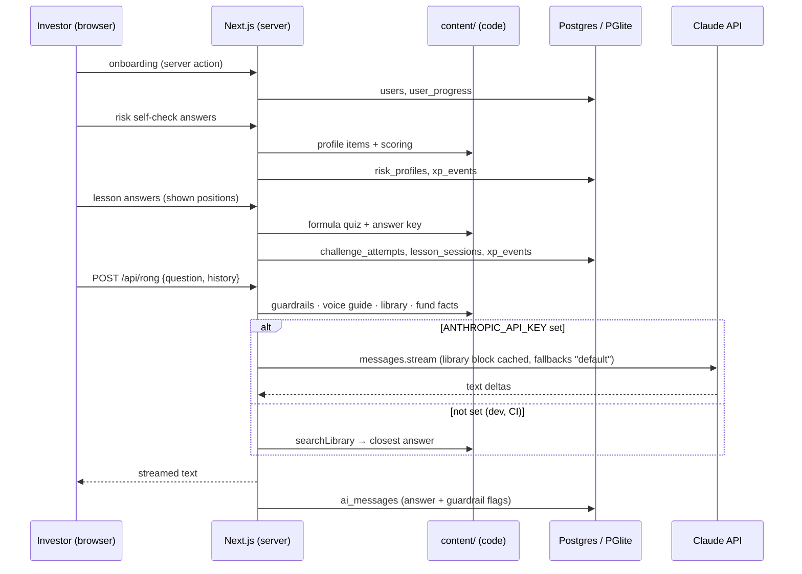

# Golden path

The thinnest journey that crosses **every layer** of the product once, kept green in CI. New
features grow outward from it; if it breaks, nothing ships.

> Run it: `npm run dev -- -p 3100`, then `BASE_URL=http://localhost:3100 npm run e2e:golden -- shots/`.
> CI runs it on every push (`.github/workflows/ci.yml`) against a production build.

## The journey

| # | Investor does | Layers it proves | Where |
|---|---|---|---|
| 1 | Opens the app, picks "Tôi mới bắt đầu", a daily goal and a nickname | middleware (anonymous id) → server action → DB (`users`) | `src/app/onboarding`, `actions/user.ts` |
| 2 | Takes the risk self-check (6 questions, no wrong answers) | content (`profile` items) → lesson engine → `content/risk` rules → DB (`risk_profiles`) | `content/risk`, `features/risk-profile` |
| 3 | Plays "Quỹ dự phòng trước tiên": context → question → 3 options → insight, gets one wrong and redoes it | formula schema → server grading with shuffled options → attempt log → re-queue → completion check → XP and streak | `content/schema.ts`, `features/lesson-engine`, `actions/lesson.ts` |
| 4 | Opens **Hỏi Rồng** and asks "Bán quỹ sau 2 năm thì mất phí và thuế gì?" | library + fund facts → guardrails + voice guide → Claude (streamed) or library fallback → reply review → DB (`ai_messages`) | `content/library`, `content/ai/rong-voice.md`, `features/ai`, `app/api/rong` |

**Pass criteria** (asserted by `e2e/golden-path.mjs`): each step reaches its screen; the lesson summary shows
"Hoàn thành bài học!" after the retry; the risk self-check returns Tăng trưởng for its answers (the
+20% / −15% regression); the Hỏi Rồng answer contains "0,1%" and no "Nguồn:" line; no page
errors.

## What is deliberately not on the path

AI role-play practice and the coach, the goal planner, leagues, quests, DragonX SSO, the help-centre
browse page. They exist (prototype or app) or are planned in [`PLAN.md`](./PLAN.md); each joins the
golden path when it becomes part of the minimum a pilot investor must be able to do.

## Rules for keeping it golden

1. Every PR keeps `npm run e2e:golden` green; CI blocks merge otherwise.
2. The path runs **without** an API key so it is free and deterministic. Model quality is measured
   by the Hỏi Rồng eval set (PLAN.md, P0), not by this test.
3. When a lesson on the path changes wording, update the option texts in the test in the same PR.
